# Vitrine: paper

**Mobile Applications, UCLL, 2026–2027, assignment 1 (PWA)**
Author: Ruben Bubba

- Live app: ✏️ *add the Vercel link*
- Code: https://github.com/rubenbubba/mobile-applications

> **How to read this draft.** Sections marked ✏️ need input from real people: interviews, test sessions, store ratings. The course asks for real research ("an invented persona only confirms your own assumptions"), so those parts are left as templates rather than made up. Everything else describes the app as it is built.

The sections follow the order of the checklist in chapter 24.9 of the course.

---

## 1. Problem statement

**Who:** owners of small local businesses, such as a bakery, a physiotherapy practice or a bicycle repair shop. They have 1–10 employees and nobody whose job is IT.

**When:** the business has a website, made once by a freelancer, a friend or a website builder, and a Google Business Profile where customers leave reviews. After launch, nobody looks after these. The owner is busy running the shop.

**What goes wrong:**

- The website goes down or its security certificate expires, and nobody notices for days. Customers notice first.
- Negative reviews stay unanswered, and the rating slowly drops.
- The site is slow on a phone, or pages are missing a title or description, so the business ranks lower on Google than it could.
- The information to spot this exists, but it is spread over four or more separate tools. Each one is built for web professionals and uses jargon like "LCP" or "meta description".

**Why it matters:** people look a local business up on their phone before they visit or call. A site that doesn't load, a 3.4-star rating with angry reviews left unanswered, or not showing up at all costs customers. The owner doesn't see this happen, and only feels it later in lost sales.

**Where this comes from:** ✏️ *Fill in after the interviews (see `user-testing/interview-guide.md`). Example: "Five owners interviewed between … and …. Four didn't know when their site had last been down. Three had never answered a review." Only write what people actually said.*

**In one sentence:** Vitrine helps owners of small local businesses keep their website, Google reviews and visibility in good shape, without technical knowledge and without checking several tools.

**What Vitrine does not solve:**

- It doesn't build or edit websites.
- It doesn't write content or run ads.
- It doesn't manage social media.
- It isn't a tool for agencies that look after dozens of clients.

It tells the owner *what* is wrong and *what to do or whom to ask*. Fixing it stays with the owner or their web designer.

## 2. Solution

Vitrine is an app that checks four things for one business: is the website up, how are the Google reviews doing, can people find the business on Google, and how fast is the site on a phone. It combines them into one score from 0 to 100, and a short, ordered list of what to fix first, in plain language.

**User scenario.** It's Monday morning, ten minutes before the bakery opens. The owner opens Vitrine from the home screen of her phone. The score is 70 ("Needs work"), and the app says: "Mostly fine, 4 things need attention." She taps **See what to fix first**.

1. At the top are two negative reviews from last week with no reply. She opens the first one, reads a suggested reply, adapts it, posts it on Google and taps **Mark as replied**.
2. Next is "Some pages have no description for Google". The app explains in plain words why this matters and lists the steps. She forwards them to her web designer and taps **Mark as fixed**.
3. A week later she taps **Run new check**. The app confirms the fix, the score goes up, and "Fix confirmed" appears in the recent changes.

**How each part of the problem is addressed:**

| Part of the problem | What Vitrine does |
|---|---|
| Site down or certificate expiring without anyone noticing | Website screen: availability over 30 days, response time, HTTPS and certificate checks. A site that is down caps the score at 35 and goes to the top of the list. |
| Unanswered negative reviews, falling rating | Reviews screen: rating trend, recent reviews, a suggested reply and "Mark as replied" |
| Poor Google visibility and a slow mobile site | "Found on Google" and Speed screens, with every finding turned into an issue with steps |
| Spread over several tools full of jargon | One score, one prioritised list, plain explanations, and "why it matters" on every issue |

**Why a mobile app and not a website:**

- **Always at hand.** The owner works on the shop floor, not at a desk. Checking happens in short moments between customers.
- **Installable and quick to open.** The PWA sits on the home screen and opens like an app, without an app store.
- **Works offline.** Saved results stay readable without a connection, for example in a shop with poor reception. Actions such as "mark as fixed" are kept.
- **Notifications** (native version, assignment 2). An alert when the website goes down is the strongest reason for a phone app: the owner hears about it before customers do. A web page can't do this reliably while it's closed.

## 3. User research

### 3.1 Target group

| | Description |
|---|---|
| Who | Owners of small local businesses in Flanders, such as shops, practices and workshops, with 1–10 employees |
| Age and skills | Wide range, roughly 30 to 65. Comfortable with WhatsApp and banking apps, but not with web jargon. |
| Context | Short sessions of 1–3 minutes, often one-handed, between customers or before opening |
| Frequency | Weekly check-ins, plus right away when something breaks |
| Device and network | Their own smartphone, Android or iPhone. Shop wifi or 4G, sometimes with weak reception indoors. |
| Primary user | The owner |
| Secondary users | An employee who answers reviews, and the web designer who receives the list of fixes. The designer doesn't use the app, but gets its output. |

✏️ *Check these assumptions in the interviews and adjust the table: age, how often they would check, Android or iPhone.*

### 3.2 Stakeholders

| Stakeholder | What they need from Vitrine | Risk if ignored |
|---|---|---|
| Business owner, who pays | A clear answer to "is everything OK?", with no jargon | They stop opening the app after a week |
| Employees | Being able to answer reviews without the owner's account | Reviews stay unanswered. Possible later feature: invite a colleague. |
| Web designer or agency | Precise, correct fix instructions | Wrong advice damages trust between owner and designer |
| Customers who write reviews | Their review and name are handled correctly | GDPR: we show public reviews but don't store more than needed |
| Google (PageSpeed and Business Profile APIs) | Use within quotas and terms | Quota errors (seen on 3 Nov 2026 without a key) or losing access |
| Supabase (database and login) and Vercel (hosting) | Correct configuration, data stored in the EU | Data leaks if row level security is wrong, or downtime |
| UCLL, the lecturer | A working, tested app and this paper | Assignment not accepted |

### 3.3 Personas

✏️ *Make two personas from the interviews, using `user-testing/persona-template.md`. Only use what you heard. Two different profiles are likely, for example a tech-averse owner and a busier, more digital one. Check whether the interviews really show that split.*

| | Persona 1 | Persona 2 |
|---|---|---|
| Name, age, business | ✏️ | ✏️ |
| Goal | ✏️ | ✏️ |
| Biggest obstacle | ✏️ | ✏️ |
| When and where they would use the app | ✏️ | ✏️ |
| Tech skills | ✏️ | ✏️ |
| Quote from the interview | ✏️ | ✏️ |

## 4. Features

Written from the user's point of view and grouped by cluster. "Data source" shows where the data comes from in this PWA version: **demo** is sample data in the app, **live** is real data.

### Account and starting up

| As an owner I want to… | so that… | The app returns | Data source | Native feature |
|---|---|---|---|---|
| log in | my data is private | my dashboard | Demo login now. Supabase Auth is built on a separate branch. | — |
| try the app with sample data | I can see what it does before I sign up | three sample businesses | demo | — |
| create an account and reset my password | I can start on my own | a confirmation email | Supabase Auth (separate branch) | — |
| install the app on my home screen | it opens like an app | an install prompt, or iPhone instructions | browser | home screen |

### Overview (Home)

| As an owner I want to… | so that… | The app returns | Data source |
|---|---|---|---|
| see one overall score | I know in one second whether things are OK | a score from 0 to 100, its status and a one-line summary | calculated in `src/logic/` from the four areas |
| see what to fix first | I don't have to prioritise myself | the top issues, sorted by severity | issue rules in `src/logic/issueRules.ts` |
| see my score over time | I can see whether my work pays off | an 11-week chart and recent changes | check history |
| run a new check | fixes get confirmed | an updated score and "Fix confirmed" entries | demo (simulated). Live check is planned. |

### Issues

| As an owner I want to… | so that… | The app returns |
|---|---|---|
| see everything that needs attention, filtered by area | I can focus | the issue list with severity |
| understand an issue | I know whether it matters | what is wrong, why it matters, and the steps to fix it in plain language |
| mark an issue as fixed, with undo | I can keep track | "Marked as fixed". The score only changes after the next check confirms the fix. |

### Website, Found on Google, Speed

| As an owner I want to… | so that… | The app returns | Data source |
|---|---|---|---|
| know whether my website is up | I hear about it before my customers do | status, response time, 30-day availability, HTTPS and certificate | demo |
| test any website right now | I can check after a fix | a real test from my phone (responded, no response, or timed out) | **live** |
| know whether Google can show my pages well | I'm found | titles, descriptions, headings, hidden pages, broken links, sitemap | demo |
| know whether my site is fast on a phone | visitors don't leave | load time and Core Web Vitals in plain words, plus what slows the site down | demo |

### Reviews

| As an owner I want to… | so that… | The app returns | Data source |
|---|---|---|---|
| see my rating and its trend | I notice a drop early | the rating, a trend, and recent reviews | demo |
| answer negative reviews quickly | customers see that I care | a suggested reply and "Mark as replied" | demo |

### Settings, privacy and robustness

| Feature | What happens |
|---|---|
| Switch business, theme (light, dark, system) | Saved on the device |
| Data sources | An honest list of what is demo and what is live. Every screen also labels its data. |
| Reset demo data | Starts the demo over |
| Log out | Back to the login screen |
| **Empty state** | Reviews not connected: an explanation of what is missing and how to connect |
| **Loading state** | Placeholder blocks shaped like the content, instead of a spinner |
| **Error state** | Website down: the score is capped and the issue goes to the top. If loading fails, there is an error with a retry button. |
| **Offline** | A banner, saved results stay visible, and "Run new check" is turned off with an explanation |
| **Unknown address** | A friendly not-found page |
| **New version** | An update message with a button that reloads into the new version |
| Delete data, download data | ✏️ *Planned with the Supabase version (see MoSCoW)* |

## 5. Competitors

| Product | What it does | What it does well | Where it falls short for our target group | Store rating |
|---|---|---|---|---|
| **UptimeRobot** (web and app) | Uptime monitoring. Free plan: 50 monitors, checked every 5 minutes, with alerts. | Reliable, free, push alerts | Only uptime: nothing on reviews, Google or speed. Built for developers. | ✏️ *check App Store and Play Store* |
| **Google Maps app, Business tab** (the old Google My Business app was discontinued in 2022) | Manage the Business Profile and answer reviews | Official, free, answers reviews directly | Nothing about the website. Reviews are buried in Maps. | ✏️ |
| **PageSpeed Insights** and **Search Console** (web) | Speed and Google-visibility reports | Free, authoritative data | Very technical, no mobile app, nothing about reviews or uptime | — |
| **BrightLocal** (web) | Local SEO, listings and review monitoring | Complete, includes review alerts | Paid (from roughly $29–39 a month), built for marketers and agencies, desktop-first | ✏️ |
| **Localo** (web) | Google Business Profile management and local rank tracking | Focus on Google Maps visibility | Paid (from roughly $39 a month), no mobile app, aimed at agencies | — |
| **Non-app: the web designer, or doing nothing** | The owner asks the web designer when something seems wrong, or never checks | Costs nothing, needs no new habit | Reactive: problems are found by customers first | — |

**Differentiation:** Vitrine brings four sources that are separate today together (uptime, reviews, Google visibility and speed), in one score with plain-language fixes. It is made for owners without technical knowledge, on the phone they always carry.

Sources:
- [UptimeRobot mobile app](https://uptimerobot.com/mobile-app/)
- [Google Business Profile help](https://support.google.com/business/answer/9274959)
- [Search Engine Land on the end of the GMB app](https://searchengineland.com/google-my-business-mobile-app-has-stopped-functioning-forever-386423)
- [BrightLocal on Capterra](https://www.capterra.com/p/182621/BrightLocal/)
- [Localo on Capterra](https://www.capterra.com/p/10018358/Localo/)

Prices are approximate; check them on the vendors' own sites before quoting.

## 6. Wireframes and design

### 6.1 Low-fidelity wireframes

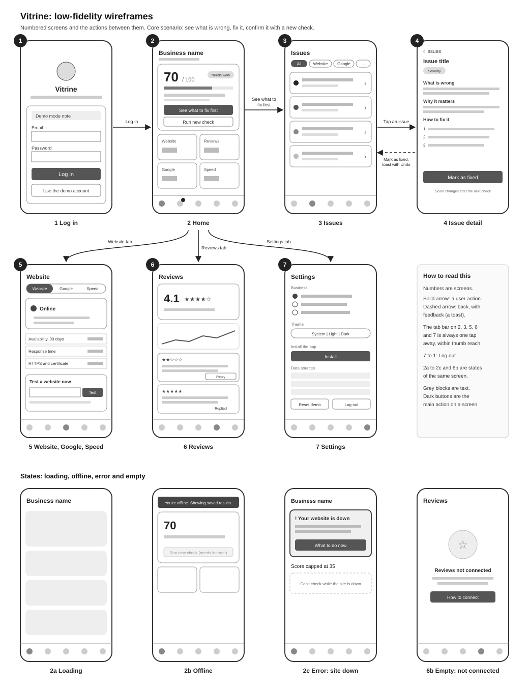

**Flow:**
- From **1 Log in** to **2 Home**.
- From Home, **See what to fix first** goes to **3 Issues**, then **4 Issue detail**. **Mark as fixed** goes back to the list, with a toast that offers Undo.
- The tab bar reaches **5 Website / Google / Speed**, **6 Reviews** and **7 Settings**, and **Log out** returns to 1.
- **2a–2c** and **6b** are the loading, offline, error and empty states.

### 6.2 High-fidelity screens (from the built app)

| | | |
|---|---|---|
| 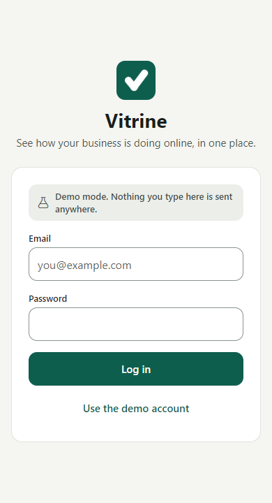 | 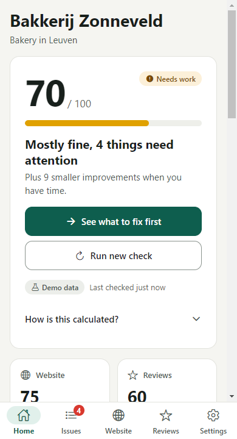 | 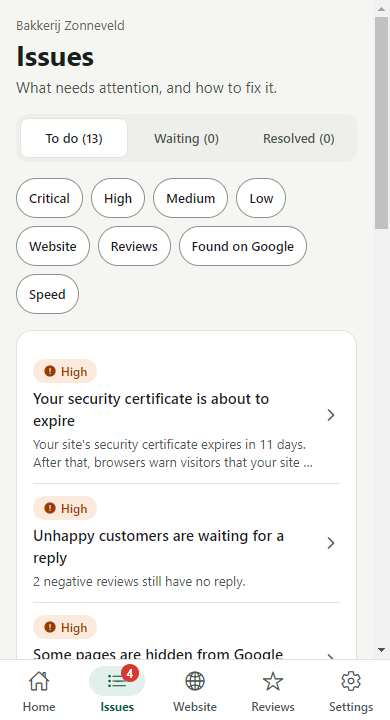 |
| 1 Log in | 2 Home | 3 Issues |
| 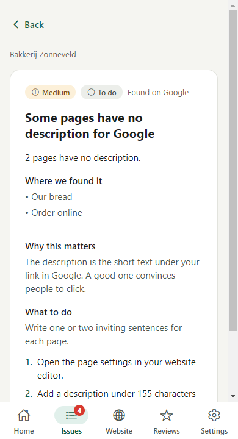 | 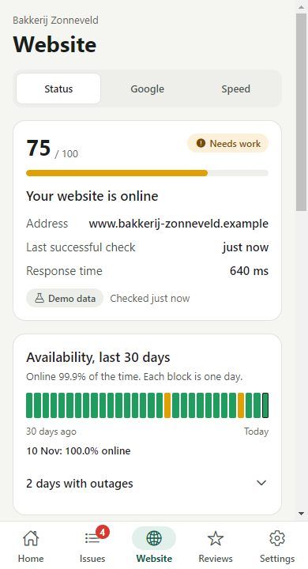 | 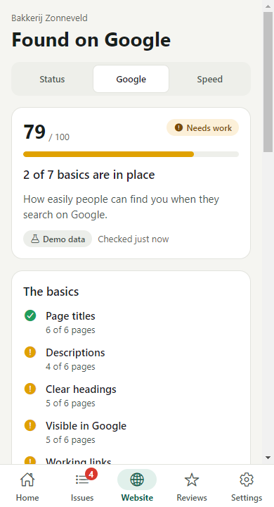 |
| 4 Issue detail | 5 Website | 5 Found on Google |
| 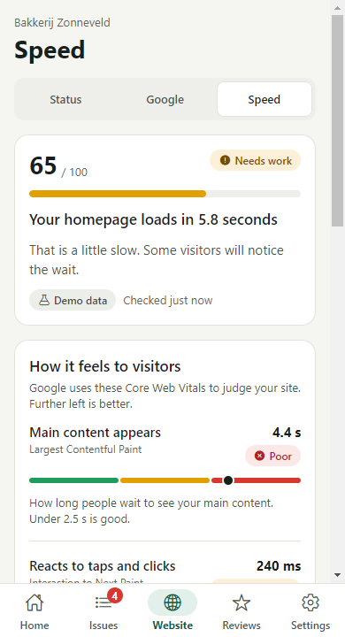 | 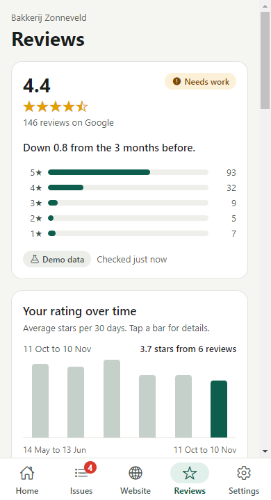 | 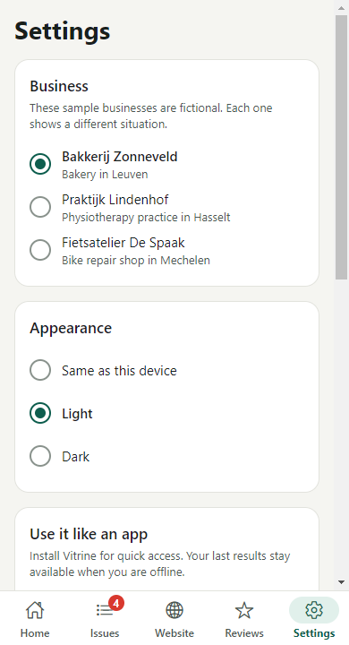 |
| 5 Speed | 6 Reviews | 7 Settings |
| 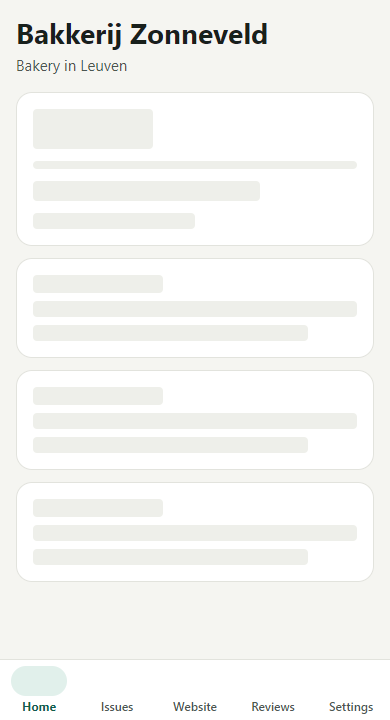 | 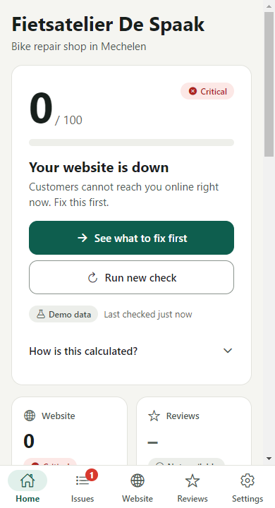 | 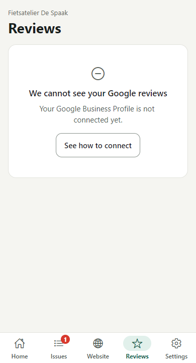 |
| 2a Loading | 2c Error: site down | 6b Empty: not connected |

### 6.3 Style guide

| Element | Choice |
|---|---|
| Colours (light) | Background `#F5F5F1`, surface `#FFFFFF`, text `#18201C`, accent `#0E5E4E` (dark green) |
| Status colours | Healthy `#1F9D5C`, warning `#E0A100`, serious `#E56A1C`, critical `#D8392E`. Status is always shown as a word plus an icon, never by colour alone. |
| Dark mode | Its own full palette (`src/theme/tokens.ts`), following the system setting or chosen in Settings |
| Spacing and shape | 4 / 8 / 12 / 16 / 24 / 32 spacing scale, rounded cards (radius 8–16) |
| Components | All shared styling lives in base components (`src/components/primitives/`), documented in Storybook (`npm run storybook`) |
| Touch targets | At least 48 px (`MIN_TOUCH_TARGET`) |

### 6.4 Design principles applied

These are the nine principles from the Mobile UX chapter.

| Principle | Where and how |
|---|---|
| Clarity and simplicity | Home answers one question ("Is my business OK online?") with one number and one main action |
| Consistency | Every area uses the same score card, status badge and "Demo data" label. All screens are built from the same base components. |
| Intuitive actions | A bottom tab bar with five fixed sections. Issues open from anywhere they appear. |
| Feedback | A toast with Undo after "Mark as fixed", "Last checked …" on every result, and "Fix confirmed" after a check |
| Accessibility | Text contrast meets WCAG AA, inputs have labels, banners use `role="status"`, and charts have a text summary for screen readers |
| Performance | Placeholder blocks while loading. The service worker saves every page, so a repeat visit doesn't wait for the network and works offline. |
| Progressive disclosure | "How is this calculated?" is collapsed. Issue details only open on tap. |
| Personalisation | Choice of business, and a light, dark or system theme |
| Touch-friendliness | 48 px targets, and the main actions sit in the lower half of the screen within thumb reach |

## 7. Timeline and roadmap

Planned backwards from the final deadline (31 Dec 2026), with margin over the holidays. Responsible for every milestone: Ruben.

| # | Date | Milestone (verifiable result) | Status |
|---|---|---|---|
| M1 | 07 Oct 2026 | Idea submitted by email | ✏️ *confirm* |
| M2 | 03 Nov 2026 | PWA with all 7 screens on demo data, offline support, and 92 passing end-to-end tests | Done |
| M3 | 10 Nov 2026 | PWA online over HTTPS, installable on a phone, paper submitted with the GitHub link | Today |
| M4 | 17 Nov 2026 | Tested with 3 people from the target group, findings written down and the top 3 fixed | ✏️ |
| M5 | 24 Nov 2026 | Real accounts: register, log in and reset a password with Supabase, data protected by row level security | Code ready on a branch |
| M6 | 01 Dec 2026 | Real checks: availability every 10 minutes, speed and Google checks through server functions | Code ready on a branch |
| M7 | 08 Dec 2026 | Native app runs on a real Android phone and iPhone (EAS development builds), with storage and network detection | Partly done |
| M8 | 15 Dec 2026 | Native feature: push notification within 10 minutes of the website going down | Planned |
| M9 | 22 Dec 2026 | Tested on physical devices, accessibility checked, bugs fixed | Planned |
| — | 23–30 Dec 2026 | **Margin** (holidays, store or build problems) | — |
| M10 | 31 Dec 2026 | Final native version submitted | Planned |

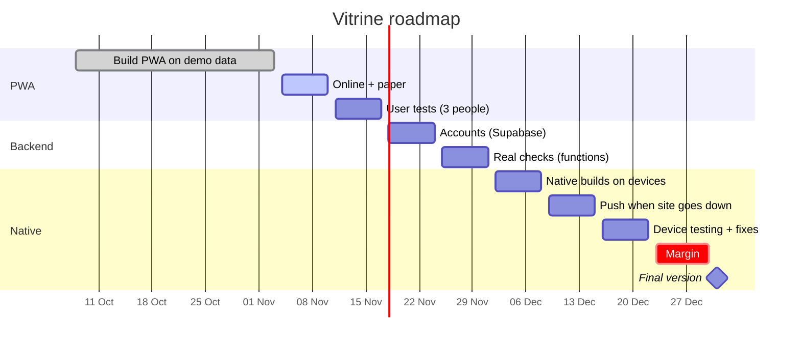

## 8. Scope (MoSCoW)

**Must have: the exam version.** Everything here must work at the exam. Each item links to a milestone.

| Feature | Milestone |
|---|---|
| Log in and log out, with a demo account | M2 (done), M5 (real accounts) |
| Home: overall score, what to fix first, the four areas | M2 (done) |
| Issues list and details with plain-language steps, mark as fixed with undo | M2 (done) |
| Website, Found on Google, Speed and Reviews screens | M2 (done) |
| Honest labelling of demo and live data | M2 (done) |
| Works offline (saved results) and installable | M2 and M3 (done) |
| Runs as a native app on Android and iOS | M7 |
| Push notification when the website goes down | M8 |

**Should have**
- Real accounts with registration and password reset (M5)
- Real website availability and speed checks (M6)
- Actions saved offline and sent when the connection returns (M5)
- Privacy policy, "Download my data" and "Delete my account" (M5)

**Could have**
- Real Google reviews. This needs the Google Places or Business Profile API, which needs a billing account.
- Dutch translation
- Inviting an employee or the web designer
- A weekly summary by email

**Won't have (this version)**
- Editing the website from the app
- Posting review replies to Google from inside the app
- Multi-location or agency dashboards
- Payments or subscriptions

**Why these choices:** the problem is that owners don't *know* what is wrong and *what to do*. The must-haves are exactly the parts that answer that: score, issues, the four areas, and the alert when the site goes down. Real accounts and real data matter, but the core value (understand, prioritise, follow up) can already be shown and tested with sample data. That's why they are should-haves. Everything that *fixes* things for the owner, or serves agencies, is left out to keep the scope realistic for one semester.

---

## Appendix A: technical choices

- **Stack:** the course's Expo starter (React Native and Expo Router), built as a static PWA. The same code becomes the native app in assignment 2.
- **Data flow:** services, then stores (Zustand), then `logic/` (pure functions), then hooks, then components. Every score is calculated in one place, so screens can't disagree.
- **PWA:** manifest, a hand-written service worker (pages are network first, falling back to cache and then the offline page; assets are cache first) and an update prompt.
- **Hosting:** Vercel over HTTPS, with clean URLs. Every push to `main` goes live.
- **Security:** no secrets in the app bundle. API keys belong in Supabase Edge Functions on the server, and all data is protected by row level security in the database.
- **Storing the login session:** on native, in `expo-secure-store` (Keychain or Keystore). In the browser there is no secure storage, so the PWA uses the browser's storage with Supabase's short-lived tokens. That is the standard trade-off for web apps.
- **Privacy (GDPR):** the Supabase project is in an EU region. The app stores only email, business details and check results. Users get a privacy policy, a data download and account deletion.

## Appendix B: tests

- 92 end-to-end, logic and layout tests with Cypress, run on the production build (`npm run cypress:run`).
- A real-Chrome offline test that installs the service worker, publishes an update, stops the server and checks that the app still works (`npm run test:offline`).
- User tests with 3 people from the target group, using `user-testing/`. ✏️ *Results:* see `user-testing/results.md`.
